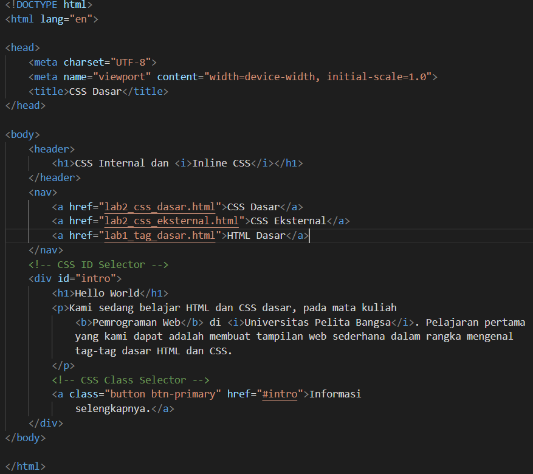
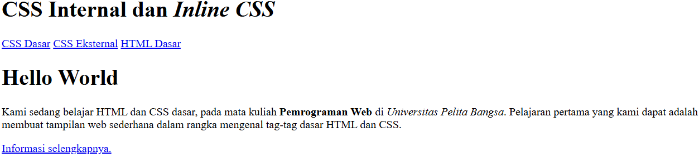
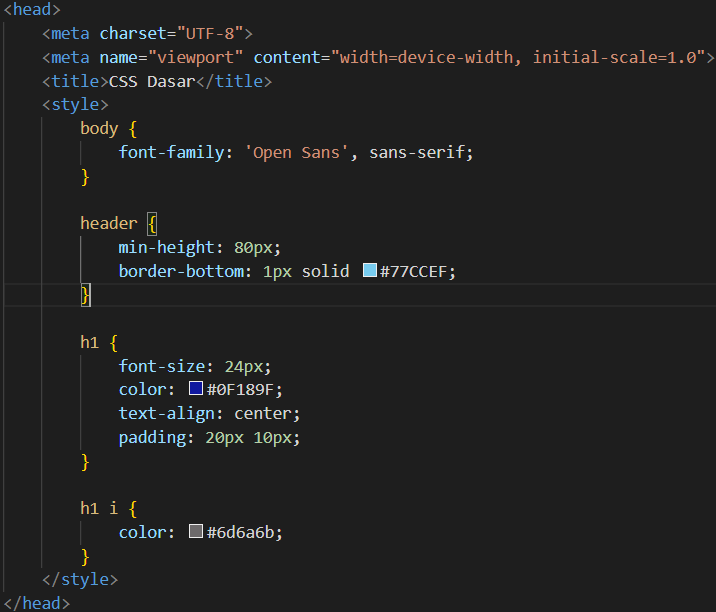
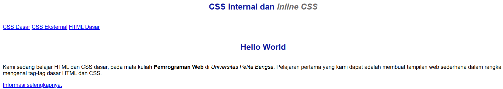
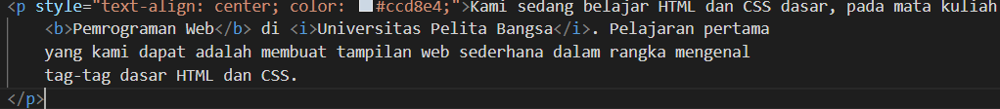
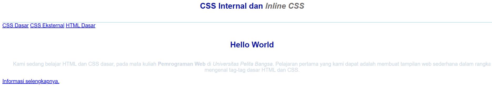
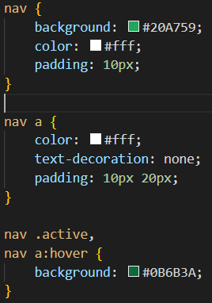
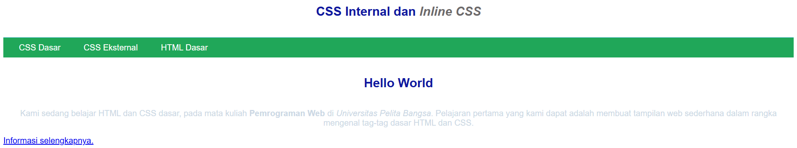
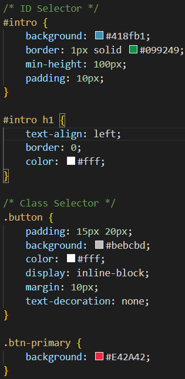
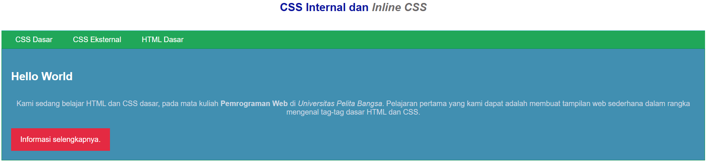

Praktikum 3 — CSS Dasar

## Identitas Praktikum

- **Nama:** Mu’ammar Kadafi
- **NIM:** 312510192
- **Program Studi/Semester:** Teknik Informatika / 3
- **Mata Kuliah:** Pemrograman Web
- **Dosen Pengampu:** Agung Nugroho, S.Kom., M.Kom.
- **Kelas:** I253C
- **Hari/Tanggal:** Sabtu, 10 Oktober 2026
- **Pertemuan:** 4 (Offline)

## Tujuan Praktikum

Praktikum ini bertujuan untuk mempelajari penerapan CSS dasar pada dokumen HTML, termasuk CSS internal, inline, dan eksternal. Praktikum juga mengenalkan penggunaan selector elemen, ID, dan class serta memahami bagaimana aturan CSS diterapkan pada elemen HTML.

## Langkah-Langkah Praktikum

1. Mempersiapkan text editor, misalnya Visual Studio Code.
2. Membuat folder kerja dengan nama `praktikum-3-css-dasar`.
3. Membuat file HTML dengan nama `lab2_css_dasar.html`.
4. Pada file lab2_css_dasar.html., membuat struktur tabel data mahasiswa dengan kode berikut.
   
   Tampilan akan terlihat seperti pada gambar berikut.
   
5. Tambahkan deklarasi CSS internal sebagai berikut.
   
   Tampilan akan terlihat seperti pada gambar berikut.
   
6. Kemudian tambahkan deklarasi inline CSS pada tag 
 seperti berikut.
   
   Perubahan tampilannya akan terlihat seperti pada gambar berikut.
   
7. Buat file baru dengan nama nama style_eksternal.css kemudian buatlah deklarasi CSS seperti berikut.
   
   Kemudian tambahkan tag <link> untuk merujuk file css yang sudah dibuat pada bagian <head>.
   Tampilan akan terlihat seperti pada gambar berikut.
   
8. Kemudian tambahkan CSS Selector menggunaka ID dan Class Selector. Pada file style_eksternal.css sebagai berikut.
   
   Tampilan akan terlihat seperti pada gambar berikut.
   
